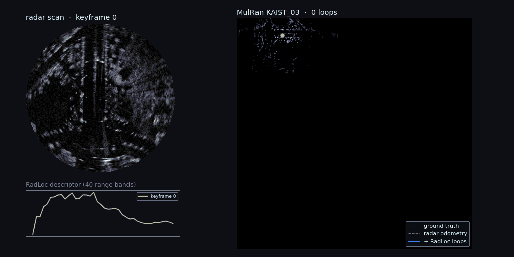

<div align="center">
  <picture>
    <source media="(prefers-color-scheme: dark)" srcset="assets/logo_dark.svg" />
    
  </picture>
  <br />
  <a href="https://github.com/sparolab/RadLoc/tree/main/cpp"></a>
  <a href="https://github.com/sparolab/RadLoc/tree/main/python"></a>
  <a href="https://pypi.org/project/radloc/"></a>
  <a href="https://github.com/sparolab/RadLoc/tree/main/applications/slam/ros1"></a>
  <a href="https://github.com/sparolab/RadLoc/tree/main/applications/slam/ros2"></a>
  <a href="#docker"></a>
  <a href="#docker"></a>
  <br />
  <a href="https://sparolab.github.io/research/radloc/"></a>
  <a href="https://arxiv.org/abs/2607.08115"></a>
  <a href="https://arxiv.org/abs/2607.08115"></a>
  <a href="https://www.youtube.com/watch?v=q8iaEpMSANU"></a>
  <a href="#robot-run-with-your-agent"></a>
  <a href="#robot-run-with-your-agent"></a>
  <a href="https://github.com/sparolab/RadLoc/actions/workflows/ci.yml"></a>
  <br />
  <a href="https://pypi.org/project/radloc/"></a>
  <br />
  
  <p>
    <strong>[IROS 2026] RadLoc: Radar-based 3-DoF Global Localization via Fast, Robust,<br />
    and Lightweight Spatial Descriptor Across Diverse Environmental Scenarios</strong>
  </p>
</div>

______________________________________________________________________

A radar sees through rain, fog and dust, and RadLoc lets it recognize where it has been and how it is turned, from a single scan:

- :compass: **Rotation invariant and tiny**: forty floats describe a place, one per range band, averaged over azimuth.
- :mag: **Two-stage search**: a k-d tree over the leading range-weighted bands proposes candidates; the full descriptor re-ranks them.
- :dart: **3-DoF registration without an initial guess**: loops are registered by phase correlation, with no correspondences and nothing to initialize.
- :repeat: **Online loop closing**: radar odometry + RadLoc loops in an iSAM2 pose graph, on ROS 1 and ROS 2.
- :world_map: **Multi-session SLAM**: sessions from different runs are aligned into one map ([guide](applications/multi-session-slam)).
- :busts_in_silhouette: **Multi-robot**: map merging from a few exchanged keyframes ([Commerge](https://github.com/sparolab/Commerge)).

## :floppy_disk: Datasets

The examples use **[MulRan](https://sites.google.com/view/mulran-pr)** `KAIST_03` (Navtech CIR204 radar, polar scans and `xypose.csv` ground truth). The odometry reads scans in the Oxford layout; convert MulRan once:

```bash
python applications/slam/tools/mulran_to_oxford.py <MulRan>/KAIST_03/polar <out>/KAIST_03/polar   # Oxford layout
```

`dataset:=mulran` (0.0596 m per range bin, also Boreas, the default) or `dataset:=oxford` (0.0432 m, Oxford Radar RobotCar) sets the range resolution; a wrong value scales the whole trajectory.

______________________________________________________________________

## :package: Installation

```bash
pip install radloc                                   # the library (NumPy, SciPy, OpenCV)
```

### Docker

```bash
docker compose -f docker/docker-compose.yml build                # ROS 2 Humble (radloc:humble)
docker build -f docker/Dockerfile.ros1 -t radloc:noetic .        # ROS 1 Noetic
```

Datasets are mounted read-only; see [docker/README.md](docker/README.md) for the paths.

### From source

<details open>
<summary><strong>C++ library</strong></summary>

```bash
cmake -S cpp -B cpp/build -DCMAKE_BUILD_TYPE=Release && cmake --build cpp/build -j8
ctest --test-dir cpp/build                  # descriptor, search and registration checks
```

In your project, `add_subdirectory(RadLoc/cpp)` and link `radloc::radloc` (header-only, OpenCV).

</details>

<details open>
<summary><strong>ROS 1 Noetic / ROS 2 Humble</strong></summary>

PCL and GTSAM 4.2, then the packages under [applications/slam](applications/slam) in a catkin or colcon workspace (keep only the ROS version you build). The Dockerfiles list every step.

</details>

______________________________________________________________________

## :rocket: Run

```bash
# ROS 2 Humble
ros2 launch radloc_slam radloc_slam.launch.py sequence_dir:=<out>/KAIST_03 save_directory:=$HOME/kaist03 dataset:=mulran
# ROS 1 Noetic
roslaunch radloc_ros radloc_slam.launch sequence_dir:=<out>/KAIST_03 save_directory:=$HOME/kaist03 dataset:=mulran
# Docker
docker compose -f docker/docker-compose.yml run --rm slam        # SEQUENCE_DIR -> SAVE_DIR
```

Radar odometry (Yeti: Cen features, ORB matching, motion-distorted RANSAC) gives the motion, the feature cloud and the RadLoc descriptor of every scan; the pose-graph node closes loops with RadLoc, registers them by phase correlation and optimizes with iSAM2. The run is saved as a **session** (`optimized_poses_kitti.txt`, `odom_poses_kitti.txt`, `keyframe_times.txt`, the `.g2o` graph, descriptors and scans).

On MulRan `KAIST_03` (6.25 km), RadLoc loops bring the radar odometry from 71.7 m to **5.4 m** mean error, the same on ROS 1 and ROS 2. Results and the trajectory figure: [applications/slam](applications/slam#results).

Without ROS:

```bash
radloc describe <out>/KAIST_03/polar --out kaist03.npy     # one descriptor per scan
radloc loops kaist03.npy --out loops.csv --exclude 100    # loop candidates within the run
```

```python
import radloc
db = radloc.PlaceDatabase()                       # coarse k-d tree on 20 bands, top 10 re-ranked
for scan in scans:                                # polar PNG paths or (range x azimuth) arrays
    db.add(radloc.compute_descriptor(scan))
matches = db.query(radloc.compute_descriptor(query), limit=len(db) - 100)   # [(index, distance), ...]
```

______________________________________________________________________

## :toolbox: Tools

### Multi-session SLAM

LT-SLAM style ([LT-mapper](https://github.com/gisbi-kim/lt-mapper)), as in [Sonar Context](https://github.com/sparolab/sonar_context) and [ReFeree](https://github.com/sparolab/ReFeree): each session keeps its own frame and gets an anchor node; inter-session RadLoc loops, registered by phase correlation, connect the sessions through their anchors. `KAIST_03` cut in two halves, each in its own frame: the second half lands within **0.75 m** (median) of the first. Results: [applications/multi-session-slam](applications/multi-session-slam#results).

```bash
multi_session_node applications/multi-session-slam/config/kaist03_split.yaml     # sessions_dir/{01,02} -> save_directory
```

See the [multi-session SLAM guide](applications/multi-session-slam).

### Multi-Robot Map Merging

Each robot keeps its RadLoc descriptors; [Commerge](https://github.com/sparolab/Commerge) (IJRR 2026) picks the few keyframes that carry the overlap, and only those are exchanged. On `KAIST_03` split into two robots (robot B in a frame turned by 60°): 27 of 2,344 keyframes exchanged (1.2 %, 2.6 KB of poses), B's frame recovered within 0.05°.

<p align="center"><a href="https://github.com/sparolab/Commerge"></a></p>

See [applications/multi-robot-slam](applications/multi-robot-slam).

______________________________________________________________________

## :robot: Run with your agent

Open [Claude Code](https://claude.com/claude-code) or [Codex](https://openai.com/codex/) in an empty folder and paste:

```text
Clone https://github.com/sparolab/RadLoc, read its AGENTS.md, and follow it to build RadLoc and run its SLAM on MulRan KAIST_03 on this machine. Ask me what you need along the way.
```

The agent follows [`AGENTS.md`](AGENTS.md): it builds the Docker image, converts the scans, runs the SLAM and checks the result.

______________________________________________________________________

## Citation

If you use RadLoc in your research, please cite our [paper](https://arxiv.org/abs/2607.08115).

<details>
  <summary><strong>See bibtex</strong></summary>

```bibtex
@inproceedings{kim2026radloc,
  author    = {Kim, Hogyun and Choi, Jiwon and Lee, Jungwoo and Cho, Younggun},
  title     = {RadLoc: Radar-based 3-DoF Global Localization via Fast, Robust, and Lightweight Spatial Descriptor Across Diverse Environmental Scenarios},
  booktitle = {IEEE/RSJ International Conference on Intelligent Robots and Systems (IROS)},
  year      = {2026}
}
```

</details>

## Contributing

Issues and pull requests are welcome.

<a href="https://github.com/sparolab/RadLoc/graphs/contributors">
  
</a>

## Acknowledgements

The radar odometry is [Yeti](https://github.com/keenan-burnett/yeti_radar_odometry) by Keenan Burnett, with the feature detector of Sarah H. Cen and Paul Newman. RadLoc builds on [ReFeree](https://github.com/sparolab/ReFeree). Related: [SOLiD](https://github.com/sparolab/SOLiD), [Commerge](https://github.com/sparolab/Commerge), [SKiD-SLAM](https://github.com/sparolab/SKiD-SLAM).

## Special Thanks

We sincerely thank **[Giseop Kim](https://gisbi-kim.github.io/)** for open-sourcing [LT-mapper](https://github.com/gisbi-kim/lt-mapper), whose multi-session design and `BetweenFactorWithAnchoring` (MIT License) our multi-session SLAM follows.

## License

BSD 3-Clause. See [LICENSE](LICENSE).
