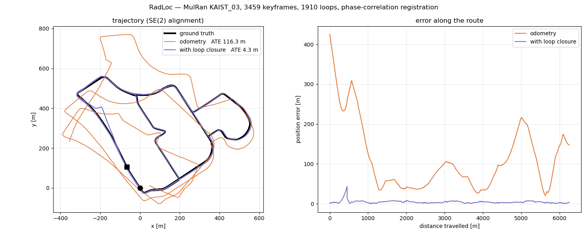

# SLAM

Radar odometry + pose-graph SLAM with RadLoc loop closing, on ROS 1 Noetic and ROS 2 Humble. Both use the same
ROS-free code in [`common/`](common):

| | |
| --- | --- |
| `common/src/{radar_utils,features,association,key_operation}.cpp` | radar odometry from [Yeti](https://github.com/keenan-burnett/yeti_radar_odometry): Cen features, ORB matching, motion-distorted RANSAC with Doppler correction |
| `common/include/radloc_slam/keyframe_store.hpp` | keyframes, their clouds and the RadLoc place database behind one lock |
| `common/src/loop_registration.cpp` | a loop proposal to a relative pose by phase correlation (`radloc::registerScans`) |
| `common/src/graph_io.cpp`, `reoptimize.cpp` | the session files; re-solving a saved pose graph with other loop noise |

| | ROS 1 Noetic ([`ros1/radloc_ros`](ros1/radloc_ros)) | ROS 2 Humble ([`ros2/`](ros2)) |
| --- | --- | --- |
| odometry | `rosrun radloc_ros odometry_node` | `ros2 run radloc_odometry odometry_node` |
| SLAM | `rosrun radloc_ros pose_graph_node` | `ros2 run radloc_slam pose_graph_node` |
| both | `roslaunch radloc_ros radloc_slam.launch sequence_dir:=... save_directory:=...` | `ros2 launch radloc_slam radloc_slam.launch.py sequence_dir:=... save_directory:=...` |

The odometry node replays `<sequence_dir>/polar/*.png` (MulRan / Oxford layout) and publishes `odom`,
`cloud_local`, `cloud_global` and `descriptor` (`RadLocDescriptor`: the range bands); the SLAM node keeps a
keyframe every `keyframe_gap_m` (0: every scan), proposes a loop for each new keyframe among those at least
`loop_min_travel_m` (10 m) back along the path, registers it by phase correlation (`loop_min_response` 0.3) and
optimizes with iSAM2. Parameters and topics are the same on both ROS versions.

**Odometry failures.** Motion-distorted RANSAC draws 2-match subsets until it is 99.9 % sure to have drawn an
all-inlier one (`ransac_confidence`, at most `ransac_max_iterations` = 2000; the published code always drew
100). A scan whose motion is then supported by fewer than `odometry_min_inliers` (10) matches is a failed match,
not an estimate: it keeps the previous motion (constant velocity) and a warning says so. On KAIST_03 this
happens on 4 scans, where at most 6 of 80–236 ORB matches agree on any motion; before, the best of 100 random
draws was taken anyway, and one such scan turned the trajectory by 33 deg and moved it 32 m.

**Radar resolution.** `dataset:=mulran` (default; 0.0596 m per range bin, also Boreas) or `dataset:=oxford`
(0.0432 m, Oxford Radar RobotCar) loads `config/<dataset>.yaml` (`radar_resolution`). A wrong value scales the
whole trajectory: with 0.0432 on MulRan it comes out about 0.73 times too short.

**Input layout.** The odometry reads the Oxford layout: one row per azimuth, 11 metadata bytes (timestamp,
encoder count, valid flag) and then the range bins. MulRan's downloaded `polar/` scans are range x azimuth
without that header; convert them once:

```bash
python3 applications/slam/tools/mulran_to_oxford.py <MulRan>/KAIST_03/polar <data>/Mulran/KAIST_03/polar
```

(The descriptor itself takes either layout: `radloc describe` and `radloc::computeDescriptor` normalise it.)

The session written to `save_directory` (`singlesession_posegraph.g2o`, `odom_poses_kitti.txt`,
`optimized_poses_kitti.txt`, `keyframe_times.txt`, `RadLocDescriptors/`, `Scans/`) is what
[multi-session SLAM](../multi-session-slam) reads.

Build without Docker: put `ros1/radloc_ros` (catkin) or `ros2/*` (colcon) in a workspace, as a symlink or a
copy, and pass `-DRADLOC_ROOT=<this repository>` if the package no longer sits at
`applications/slam/ros*/` in it.

## Results

MulRan `KAIST_03` (6.25 km), 3459 keyframes, 1916 loops. Mean position error (ATE) against MulRan's ground truth after a rigid SE(2) alignment, no scale:

| | ATE mean | RMSE | max |
| --- | --- | --- | --- |
| odometry | 71.7 m | 80.4 m | 173.7 m |
| with RadLoc loop closure | **5.4 m** | **6.1 m** | **12.4 m** |

ROS 1 and ROS 2 give the same result (ROS 1: 1918 loops, 5.4 m). On 4 of the 3,460 scan pairs the odometry's feature matches agree on no motion (at most 6 of 80–236 matches); those scans keep the previous motion instead of taking a wrong one.

<p align="center"></p>
